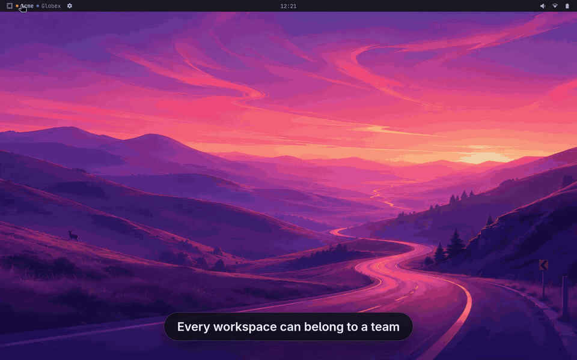

# Projectspaces for Omarchy

**Give every workspace a team: its folder, its env, its browser.**



▶ **[Watch the one-minute demo](https://mehiel.github.io/mehiel.omaprojectspace/)**

Attach a Hyprland workspace to a **projectspace**, a team folder under
`~/Projects` whose [mise](https://mise.jdx.dev) config sets the team's env.
Everything launched on that workspace starts in that folder with that env:
- apps from the launcher
- keybinds
- terminals
- herdr

Use it to give each team its own Chrome profile, Claude config dir, herdr
session, cloud profile and tool versions, all switched by the workspace
you're on.

The bar widget replaces the stock workspace switcher. It names each workspace,
marks attached ones with their projectspace's color, and has a panel for
attaching and renaming from the keyboard.

## Projectspaces are folders

A projectspace is any folder one level under `~/Projects` with a mise config
at its root: `mise.toml`, `mise.local.toml`, `.mise.toml` and so on. There is
nothing else to register. The folder's mise env is the projectspace's
configuration:

```toml
# ~/Projects/acme/mise.local.toml
[env]
CLAUDE_CONFIG_DIR = "{{env.HOME}}/.claude.acme"
HERDR_SESSION = "acme"
BROWSER = "{{env.HOME}}/.local/bin/chrome-acme"   # a script that opens Chrome's Acme profile

# Optional, read by Projectspaces itself:
PROJECTSPACE = "Acme"                 # display name (default: the folder name)
PROJECTSPACE_COLOR = "#4C8DDB"        # its dot (default: a color picked from the name)
PROJECTSPACE_ICON = ""               # a glyph instead of the dot

[tools]
java = "21"
```

Projects inside the folder inherit all of this through mise's usual config
hierarchy.

The only state Projectspaces keeps is which workspace is attached to which
folder, in `~/.config/omaprojectspace/attachments.json`.

## How launches get the env

Omarchy launches everything through `uwsm-app`:
- the app launcher
- `o.launch` keybinds
- `omarchy-launch-terminal`, `-tui`, `-webapp`, `-editor`

`omaprojectspace install` links a shim as `~/.local/bin/uwsm-app`, which comes
ahead of `/usr/bin` on the session PATH. For each launch, the shim:

1. reads the active workspace from Hyprland;
2. stops there if the workspace has no attachment, and runs the real
   `uwsm-app` with the launch untouched;
3. otherwise runs `mise env` in the projectspace folder and exports the result,
   plus `PROJECTSPACE` and `PROJECTSPACE_HOME`;
4. changes into the folder. A terminal that would have opened in `$HOME` opens
   there instead. A terminal opened from another terminal keeps that
   terminal's directory.
5. hands off to `/usr/bin/uwsm-app`.

The shim adds about 20–35 ms per launch.

### The Quake console

Omarchy's Quake console (`SUPER + grave`, the `special:qconsole` workspace)
seeds its agent from whatever workspace is underneath, and keeps that env.
To give it a fixed one instead, add a `qconsole` key to `attachments.json`
by hand:

```json
{
  "version": 1,
  "qconsole": "none",
  "workspaces": { "9": "~/Projects/acme" }
}
```

| `qconsole` | Launches while the console is open get |
|---|---|
| missing | the env of the workspace underneath (stock behaviour) |
| `"none"` | no projectspace: your personal defaults (`~/.claude`, …) |
| `"~/Projects/acme"` | that projectspace's env, always |

It applies to launches made while the console is open, so close the console
agent once for a change to take effect.

The shim never blocks a launch. If the config is untrusted or broken, the folder
is gone, or any other error occurs, the app still starts, without the
projectspace env, and you get a notification.

Session daemons pass through untouched: hyprsunset, udiskie, the monitor
watcher and the shell. `OMAPROJECTSPACE=off` turns the shim off for one
launch, or for a whole session.

Browser keybinds (Super+Shift+B, Super+Shift+Return) open the projectspace's
`$BROWSER` when it sets one. The stock launcher hands URLs straight to a running
Chrome and would bypass the shim.

## Install

```sh
omarchy plugin add https://github.com/mehiel/mehiel.omaprojectspace
~/.config/omarchy/plugins/mehiel.omaprojectspace/bin/omaprojectspace install
omarchy bar put mehiel.omaprojectspace      # then remove omarchy.workspaces if you like
omaprojectspace doctor
```

`install` links three things and reloads Hyprland:
- the CLI and the `uwsm-app` shim, into `~/.local/bin`
- `hypr/omaprojectspace.lua` (Super+Alt+P and the browser binds), required from
  `hyprland.lua`

`omaprojectspace uninstall` removes all of it. Requires Omarchy 4 (the
Quickshell shell and Hyprland Lua config), mise, and jq.

## The widget

On the strip:
- The active workspace shows by name. The other workspaces on this monitor
  appear when you hover.
- An attached workspace carries its projectspace's dot, and is named after it
  unless you gave it a name of your own.
- Hovering a workspace shows a tooltip with its folder and window count.
- Click a workspace to go there. Right-click it to open the panel on that row.
- The strip collapses 120 ms after the pointer leaves. To change that, set
  `"hoverOutDelayMs"` on the widget's entry in `~/.config/omarchy/shell.json`.

The panel opens from the gear, a right-click, or **Super+Alt+P**. It appears on
the monitor you're on.

| Key | |
|---|---|
| ↑ ↓ / j k / 1–0 | pick a workspace |
| ← → / h l | cycle its projectspace (None → each projectspace) |
| Enter | go to it |
| e | rename it (empty restores the default) |
| x | clear: the projectspace first, then the custom name |
| t | open a terminal in its projectspace, with its env |
| c | edit its projectspace's mise config |
| o / O | restore its saved windows / every saved workspace's |
| s | save its windows as its setup |
| r | refresh |
| [ / ] | the previous / next screen's tab |

With more than one monitor, a tab per screen sits on top (Laptop, Dell…),
and the panel opens on the screen it was opened from. Any screen's workspaces
can be named, attached, saved and restored from any other. A screen that is
unplugged keeps a tab, marked so, while anything in it is attached or named.
The workspaces of the shown screen are on the left. A link icon marks one
whose project is on another screen too; hover it to see where, click it to go
to that screen's tab.

Omarchy gives every monitor workspaces 1–10 of its own: the laptop panel has
ids 1–10, the next monitor 11–20, and so on. The strip and the panel show the
monitor's own ten, numbered 1–0 as the keys are, followed by any workspace
visiting from an unplugged monitor. Attachments, saved windows and names are
kept by id, and when Omarchy renumbers a workspace (moved to another monitor
with Super+Shift+Alt+arrow, or sent elsewhere by an unplug) they follow it to
its new id.

A project can be attached on more than one monitor, say its editors on the
laptop and its chat or browser on the external one. Going to one of its
workspaces, by key, bar or panel, brings up its workspace on each other
monitor too, and keeps focus where you went. A monitor with none of the
project's workspaces, or one already showing one of them, is left alone, and
moving focus between monitors switches nothing. Super+Shift+Ctrl+arrow then
moves a window to the project's workspace on the other screen.

On the right, the selected one's details:
- chips to attach a projectspace;
- for a project on one screen only, **Attach on Dell 8** for the same slot
  on the other, or a way to pick one there when that slot is taken;
- what its mise config sets beyond your global config;
- a **Trust** button when mise refuses an untrusted config;
- what is open on it now: its layout drawn in miniature (a scrolling
  layout's off-screen columns included) and its windows. Click one to go
  there;
- its saved windows, which of them are open, and **Restore**, **Save again**
  and **Forget**.

At the bottom, a switch reopens every saved workspace's windows at login. On
a narrow screen the two columns stack.

## Restoring windows

Hyprland doesn't bring windows back after a logout or reboot. Set a
workspace up with the windows it needs, then save it: **s** in the panel, or
`omaprojectspace save --ws N`. Saving is on demand only, so a workspace's save
is the setup you chose, not whatever happened to be open. It records what it
takes to reopen each window:

- **a terminal:** its folder, and the session it runs when that's herdr, tmux
  or zellij. The session's server keeps the panes, so reattaching brings them
  back;
- **the browser:** one window per workspace. Chrome's own "Continue where you
  left off" brings back the tabs;
- **an app or a web app:** its desktop entry. A Chrome web app is matched by
  its URL and profile.

Saving again replaces the workspace's setup; **Forget** drops it. The saves
live in `~/.config/omaprojectspace/windows.json`.

`omaprojectspace restore`, the panel's **o** (this workspace) or **O** (every
saved one), or the login switch reopens what is missing from the setup. Each
window opens on its own workspace, without taking focus, through the shim, so
it gets that workspace's projectspace env. Windows that are open again
already, and apps open on another workspace, are left alone, so restoring
twice is safe.

Not restored: where windows sat in the layout, what ran in a plain shell, and
windows without a desktop entry (`omaprojectspace save` names them).

## CLI

```
omaprojectspace list [--json]                 projectspaces and their workspaces
omaprojectspace attach <ws> <name|path>       attach workspace <ws> (11–20 on a second monitor)
omaprojectspace detach <ws>
omaprojectspace renumber <from>:<to>...       carry attachments, saved windows and names to new ids
omaprojectspace status [--ws N] [--json]      the active (or given) workspace's projectspace
omaprojectspace env [--ws N | --name P]       the env a launch there gets
omaprojectspace exec [--ws N | --name P] -- cmd
omaprojectspace browser [url]                 the projectspace's $BROWSER, else the default
omaprojectspace save [--ws N]                 save the workspace's windows as its setup
omaprojectspace forget [--ws N]               drop its saved windows
omaprojectspace windows [--json]              saved windows and which are missing; --json adds what is open now
omaprojectspace restore [--ws N] [--dry-run]  reopen the missing ones, each on its workspace
omaprojectspace doctor                        check links, session PATH, every projectspace
```

Set `OMAPROJECTSPACE_ROOTS` (colon-separated) to scan folders other than
`~/Projects`.

## Limits

- **Running single-instance apps keep their own env.** A Slack desktop that is
  already running does not switch projectspaces. Chrome is fine, because a
  profile hand-off opens a window in the right profile.

  For Slack and similar apps, the better setup is one Omarchy web app per team,
  kept on that team's workspace. Give `omarchy webapp install` a custom exec
  that runs the team's browser script, for example
  `~/.local/bin/chrome-acme --app=https://acme.slack.com`, so the app runs in
  that team's Chrome profile. This setup:
  - **isolates teams:** each workspace signs in to its own team only;
  - **preserves privacy:** cookies, sessions and notifications stay in that
    team's profile, so one client never sees another's;
  - **keeps the projectspace self-contained:** its folder, env, browser and chat
    all belong to it;
  - **feels just as native:** an Omarchy web app is not a browser tab. Like the
    desktop app, it has:
    - its own window, with no tabs or address bar;
    - its own launcher entry and icon;
    - desktop notifications;
  - **is lighter:** it runs on the Chrome you already have, without a separate
    Electron runtime.

  Declaring these web apps in the projectspace's mise config isn't built yet.
- **A few apps ignore `$BROWSER`.** Apps launched in a projectspace inherit
  its `$BROWSER`, and most open links with it. The few that skip it and ask
  the desktop directly open links in the default browser instead.
- **Windows keep the env they started with.** Moving a window to another
  workspace doesn't change it.

## Development

[docs/design.md](docs/design.md) explains how the pieces fit and why.

```sh
node tests/model.test.js        # Model.js: labels, colors, attachments, the strip
bash tests/cli.test.sh          # CLI and shim, against stubbed mise/hyprctl/uwsm-app
tests/preview/run 7 out.png     # render the strip + panel on an unfocused monitor
```

The preview takes these env vars:
- `PREVIEW_SCRIPT='[["attach",6,"/path"],["startRename",2]]'` calls widget
  methods before the screenshot.
- `OMAPROJECTSPACE_CONFIG_DIR` points the preview at a throwaway attachments
  file.

QML changes need a shell restart: `omarchy-restart-shell`.

### The demo

`demo/` reproduces the video from scratch, with made-up teams (Acme, Globex,
Initech). It runs in a nested Hyprland, so your session is untouched.

```sh
demo/build-vpointer                     # a scripted pointer for the nested session
demo/record /tmp/omaps-demo take        # fullscreen on eDP-1 (DEMO_MONITOR=...), ~90 s
demo/render take docs/media             # captions, zooms, cards → demo.mp4, demo.gif
demo/session /tmp/omaps-demo stop
```

The nested session keeps its own D-Bus and shell. Its power, lock and logout
commands, and any attempt to export its env to systemd, are logged no-ops: the
demo cannot suspend, log out of, or reconfigure the real session.
