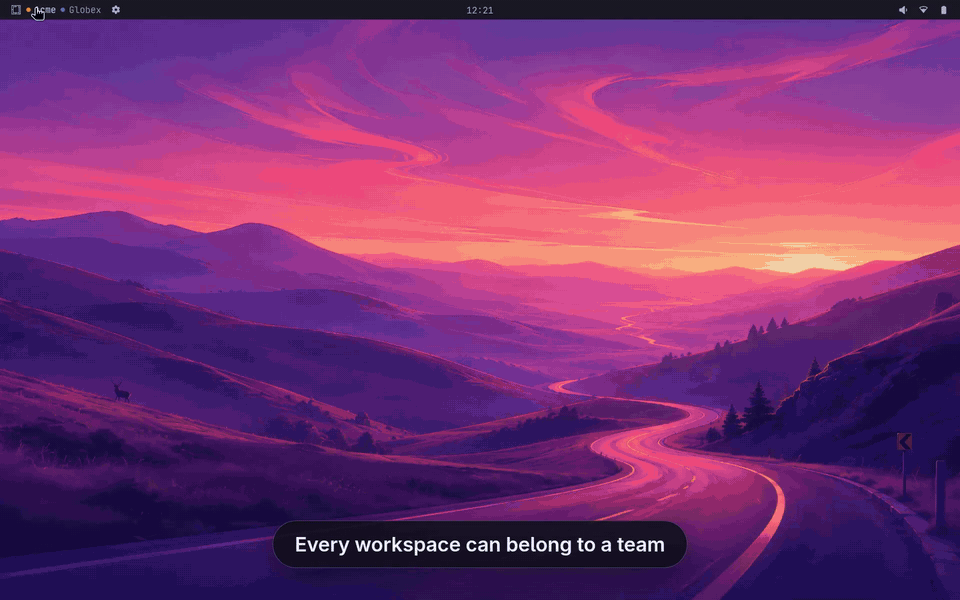

# Projectspaces for Omarchy

**Give every workspace a team: its folder, its env, its browser.**



▶ **[Watch the one-minute demo](https://mehiel.github.io/mehiel.omaprojectspace/)**

Attach a Hyprland workspace to a **projectspace**, a team folder under
`~/Projects` whose [mise](https://mise.jdx.dev) config sets the team's env.
Everything launched on that workspace starts in that folder with that env:
- apps from the launcher
- keybinds
- terminals
- herdr

Use it to give each team its own Chrome profile, Claude config dir, herdr
session, cloud profile and tool versions, all switched by the workspace
you're on.

The bar widget replaces the stock workspace switcher. It names each workspace,
marks attached ones with their projectspace's color, and has a panel for
attaching and renaming from the keyboard.

## Projectspaces are folders

A projectspace is any folder one level under `~/Projects` with a mise config
at its root: `mise.toml`, `mise.local.toml`, `.mise.toml` and so on. There is
nothing else to register. The folder's mise env is the projectspace's
configuration:

```toml
# ~/Projects/acme/mise.local.toml
[env]
CLAUDE_CONFIG_DIR = "{{env.HOME}}/.claude.acme"
HERDR_SESSION = "acme"
BROWSER = "{{env.HOME}}/.local/bin/chrome-acme"   # a script that opens Chrome's Acme profile

# Optional, read by Projectspaces itself:
PROJECTSPACE = "Acme"                 # display name (default: the folder name)
PROJECTSPACE_COLOR = "#4C8DDB"        # its dot (default: a color picked from the name)
PROJECTSPACE_ICON = ""               # a glyph instead of the dot

[tools]
java = "21"
```

Projects inside the folder inherit all of this through mise's usual config
hierarchy.

The only state Projectspaces keeps is which workspace is attached to which
folder, in `~/.config/omaprojectspace/attachments.json`.

## How launches get the env

Omarchy launches everything through `uwsm-app`:
- the app launcher
- `o.launch` keybinds
- `omarchy-launch-terminal`, `-tui`, `-webapp`, `-editor`

`omaprojectspace install` links a shim as `~/.local/bin/uwsm-app`, which comes
ahead of `/usr/bin` on the session PATH. For each launch, the shim:

1. reads the active workspace from Hyprland;
2. stops there if the workspace has no attachment, and runs the real
   `uwsm-app` with the launch untouched;
3. otherwise runs `mise env` in the projectspace folder and exports the result,
   plus `PROJECTSPACE` and `PROJECTSPACE_HOME`;
4. changes into the folder. A terminal that would have opened in `$HOME` opens
   there instead. A terminal opened from another terminal keeps that
   terminal's directory.
5. hands off to `/usr/bin/uwsm-app`.

The shim adds about 20–35 ms per launch.

The shim never blocks a launch. If the config is untrusted or broken, the folder
is gone, or any other error occurs, the app still starts, without the
projectspace env, and you get a notification.

Session daemons pass through untouched: hyprsunset, udiskie, the monitor
watcher and the shell. `OMAPROJECTSPACE=off` turns the shim off for one
launch, or for a whole session.

Browser keybinds (Super+Shift+B, Super+Shift+Return) open the projectspace's
`$BROWSER` when it sets one. The stock launcher hands URLs straight to a running
Chrome and would bypass the shim.

## Install

```sh
omarchy plugin add https://github.com/mehiel/mehiel.omaprojectspace
~/.config/omarchy/plugins/mehiel.omaprojectspace/bin/omaprojectspace install
omarchy bar put mehiel.omaprojectspace      # then remove omarchy.workspaces if you like
omaprojectspace doctor
```

`install` links three things and reloads Hyprland:
- the CLI and the `uwsm-app` shim, into `~/.local/bin`
- `hypr/omaprojectspace.lua` (Super+Alt+P and the browser binds), required from
  `hyprland.lua`

`omaprojectspace uninstall` removes all of it. Requires Omarchy 4 (the
Quickshell shell and Hyprland Lua config), mise, and jq.

## The widget

On the strip:
- The active workspace shows by name. The other workspaces on this monitor
  appear when you hover.
- An attached workspace carries its projectspace's dot, and is named after it
  unless you gave it a name of your own.
- Hovering a workspace shows a tooltip with its folder and window count.
- Click a workspace to go there. Right-click it to open the panel on that row.

The panel opens from the gear, a right-click, or **Super+Alt+P**. It appears on
the monitor you're on.

| Key | |
|---|---|
| ↑ ↓ / j k / 1–0 | pick a workspace |
| ← → / h l | cycle its projectspace (None → each projectspace) |
| Enter | go to it |
| e | rename it (empty restores the default) |
| x | clear: the projectspace first, then the custom name |
| t | open a terminal in its projectspace, with its env |
| c | edit its projectspace's mise config |
| r | refresh |

Below the list, the selected workspace's projectspace:
- chips to attach a projectspace;
- what its mise config sets beyond your global config;
- a **Trust** button when mise refuses an untrusted config.

## CLI

```
omaprojectspace list [--json]                 projectspaces and their workspaces
omaprojectspace attach <ws> <name|path>       attach workspace 1–10
omaprojectspace detach <ws>
omaprojectspace status [--ws N] [--json]      the active (or given) workspace's projectspace
omaprojectspace env [--ws N | --name P]       the env a launch there gets
omaprojectspace exec [--ws N | --name P] -- cmd
omaprojectspace browser [url]                 the projectspace's $BROWSER, else the default
omaprojectspace doctor                        check links, session PATH, every projectspace
```

Set `OMAPROJECTSPACE_ROOTS` (colon-separated) to scan folders other than
`~/Projects`.

## Limits

- **Running single-instance apps keep their own env.** A Slack desktop that is
  already running does not switch projectspaces. Chrome is fine, because a
  profile hand-off opens a window in the right profile. The intended setup for
  Slack and similar apps is one webapp per projectspace in that projectspace's
  Chrome profile, defined in its mise config; this isn't built yet.
- **Links clicked inside other apps** go to the desktop's default browser.
- **Windows keep the env they started with.** Moving a window to another
  workspace doesn't change it.

## Development

[docs/design.md](docs/design.md) explains how the pieces fit and why.

```sh
node tests/model.test.js        # Model.js: labels, colors, attachments, the strip
bash tests/cli.test.sh          # CLI and shim, against stubbed mise/hyprctl/uwsm-app
tests/preview/run 7 out.png     # render the strip + panel on an unfocused monitor
```

The preview takes these env vars:
- `PREVIEW_SCRIPT='[["attach",6,"/path"],["startRename",2]]'` calls widget
  methods before the screenshot.
- `OMAPROJECTSPACE_CONFIG_DIR` points the preview at a throwaway attachments
  file.

QML changes need a shell restart: `omarchy-restart-shell`.

### The demo

`demo/` reproduces the video from scratch, with made-up teams (Acme, Globex,
Initech). It runs in a nested Hyprland, so your session is untouched.

```sh
demo/build-vpointer                     # a scripted pointer for the nested session
demo/record /tmp/omaps-demo take        # fullscreen on eDP-1 (DEMO_MONITOR=...), ~90 s
demo/render take docs/media             # captions, zooms, cards → demo.mp4, demo.gif
demo/session /tmp/omaps-demo stop
```

The nested session keeps its own D-Bus and shell. Its power, lock and logout
commands, and any attempt to export its env to systemd, are logged no-ops: the
demo cannot suspend, log out of, or reconfigure the real session.
